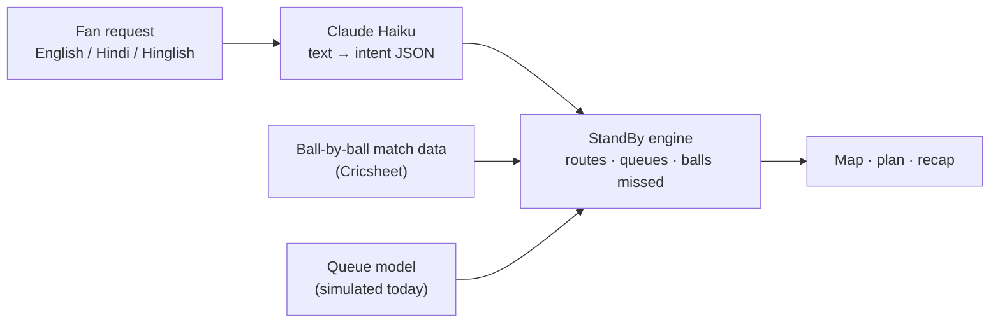

# StandBy: don't miss a ball

**An in-stadium companion that tells cricket fans where to go, when to go, and exactly how much play each trip will cost them.**

> 🔗 **Live demo:** `<paste your Vercel link here>`


## 1. The problem

Anyone who has been to a live match knows this moment: the innings break starts, and **thousands of people stand up at the same time** and head for the same few toilets and food stalls.

From informal conversations with friends who regularly attend matches (this is not a formal survey), the same frustrations kept coming up:

| What fans told us | Why it hurts |
|---|---|
| "I don't know which toilet is less crowded, so I just go to the closest one." | Everyone does this, so the closest one is always the worst. |
| "I missed a wicket / a six while I was in the queue." | The real cost isn't the wait, it's the cricket missed. |
| "I don't know when to go." | Fans leave at the worst possible moment: during a big over, or the second the break starts. |
| "My parents / a wheelchair user in our group can't take the stairs." | Signage rarely says which routes are step-free. |
| "Someone next to me asked why it was a free hit. I couldn't explain." | New fans and visitors don't know umpire signals or rules. |
| "Not everyone is comfortable in English." | Most stadium information is English-only. |

**The core insight:** a queue measured in minutes means little to a fan. **A queue measured in balls of play missed** means everything.

---

## 2. The solution

StandBy plans every trip from **your seat** and prices it in the unit fans care about: **balls missed**.

### Features

- **Balls-missed routing.** For toilets, food, first aid and exit gates, StandBy picks the option that costs the fewest balls (walk there, queue, walk back), not just the nearest one. It also shows how many balls you save compared with the closest option.
- **"Go now" nudges.** Before the innings break it warns you to leave early. After the break it points to quiet moments, like the end of an over with no wicket pending.
- **"While you were away" recap.** Tap *I'm heading there*, then *I'm back*. You get a one-line summary of what you missed: balls, fours, sixes, wickets and the current score.
- **Step-free routing.** One toggle removes stairs from every route.
- **Umpire signal explainer.** When something happens (wide, no-ball, out, four, six, DRS review), a card explains the signal and what happens next, in English or Hinglish. The rule text is fixed and written by hand, never generated, so it can't be wrong.
- **Ask in your own words.** Type "jaldi kuch khane ko" or "wheelchair toilet" and StandBy understands.
- **Queue lab.** A built-in simulator compares three crowd strategies during the break rush.
- **Guided pitch demo.** One button plays a 40-second story of the whole product.

### The key design decision: the model does language, the engine does numbers



The AI model only turns messy human language into a small, validated JSON intent (`nearest`, `explain` or `unknown`, plus a facility type and a step-free flag). Distances, queue times and scores come from our own deterministic engine, so **the model can never invent a queue, a toilet or a score.** If the AI is unavailable, the app falls back to keyword matching and says so on screen.

---

## 3. Does it work? (simulation results)

The *Queue lab* simulates a toilet rush in the first 10 minutes of the innings break: 3,000 fans start in random stands, and the four toilet blocks are different sizes, as real ones are. Everyone uses StandBy in this run.

| Plan | Avg balls missed | Worst 5% | Longest queue |
|---|---|---|---|
| Everyone goes to the nearest | 15.8 | 35.3 | 22.6 min |
| Everyone goes to the emptiest (queue info 2 min old) | 17.0 | 35.9 | 9.6 min |
| **StandBy spreads people by capacity** | **14.2** | **22.2** | 9.7 min |

**What this shows, in our simulation:**

1. Spreading fans by capacity cut the average balls missed by about 11% and the worst-5% case by about 37%.
2. Sending everyone to the *emptiest* toilet is **worse** than the nearest on average, because everyone herds to the same place at once. Good advice has to account for the crowd that is also following it.

> ⚠️ These numbers come from a simulation with assumed toilet sizes and fan behaviour. They show the *shape* of the effect, not a measured real-world result. Real venues need real data (see the roadmap).

---

## 4. What is real and what is simulated

We want to be upfront about this.

| Part | Status |
|---|---|
| Ball-by-ball match data (scores, overs, fours, sixes, wickets, DRS) | **Real**, from [Cricsheet](https://cricsheet.org) |
| Innings-break timing | Derived from the match data |
| Crowd and queue lengths | **Simulated** (fluid-queue model with a surge at the break) |
| Stadium map and walking distances | **Schematic**, not a surveyed floor plan |
| Intent parsing (English / Hindi / Hinglish) | AI (Claude Haiku) when deployed, keyword matching as fallback |
| Routes, queue times, balls-missed numbers, recap counts | Our own engine |

---

## 5. How this grows: from demo to real stadium

Today the queue numbers are simulated. Here is how each piece gets replaced with real signals, step by step.

### Phase 1: Real signals without new hardware
- **Gate-scan counts** show how many people are inside and entering each stand.
- **One-tap fan reports** ("this queue is long / short") give crowd-sourced queue data.
- **Wi-Fi / app-session density** gives a rough count of people per zone.

### Phase 2: Computer vision for crowd density (YOLO and friends)
Venues already have CCTV. A vision model can turn those feeds into live queue and crowd numbers.

- **Person detection with YOLO** (for example Ultralytics YOLO) counts people in the camera view of each toilet or stall entrance. Queue length divided by service rate gives a wait estimate. This replaces our simulated `Q` in `buildQ()`.
- **Density estimation for packed areas.** In very dense crowds, people block each other and box-based detection undercounts. Crowd-counting models such as CSRNet-style density maps work better there. A sensible approach is to use YOLO for queues and entrances, and a density model for concourses.
- **Edge inference.** Run the model on a small GPU box in the stadium and send only counts to the app, never video.
- **Privacy by design.** Count people, don't identify them. No faces, no stored footage, only aggregate numbers per zone every few seconds. Anything real needs the venue's data-protection review first.
- **Calibration.** Each camera is mapped to a facility. A short on-site calibration step compares model counts with manual counts.

### Phase 3: Predicting, not just reporting
A live count tells you what the queue is *now*. Fans need to know what it will be when they *arrive*.

- A **time-series forecaster** (for example gradient-boosted trees) predicts queue length 5 to 10 minutes ahead. Its inputs would be match state (overs left, wickets, approaching break or rain delay), current counts and historical patterns.
- Better **dispersal logic**: optimise recommendations across all fans at once, so we do not create a new herd (the "emptiest" trap shown above). Our capacity-aware strategy is the first step toward this.

### Phase 4: Beyond one feature
- **Dream11 hook:** warn a fan before their picked batter is due in, or a captain's over is about to start.
- **Other sports:** football half-time, kabaddi and basketball breaks have the same problem.
- **Real indoor map:** replace the schematic with a surveyed venue graph (GeoJSON), including real stair and lift data.
- **More languages:** Tamil, Telugu, Bengali, Marathi and others, using the same intent layer.
- **Safety:** crowd-density alerts for stewards, and first-aid routing.

---

## 6. Who benefits

| Who | How |
|---|---|
| **Fans** | Less time away from the action, a calmer break, and no guessing. |
| **Fans with accessibility needs** | Step-free routes in one tap. |
| **New and visiting fans** | Rules and signals explained in plain English or Hinglish. |
| **Stadium operators** | Demand is spread across blocks, which means shorter peak queues and safer concourses. Crowd data also helps with staffing. |
| **Food and drink vendors** | Fewer abandoned queues and a more even flow of customers. |
| **Fantasy and fan platforms (for example Dream11)** | Fans who miss less play stay more engaged with the match. |

### How we would pilot it
1. Pick **one stand** at one venue and the four nearest toilet blocks.
2. Collect gate-scan counts and fan reports for 2 to 3 matches to build a baseline.
3. Switch on recommendations for a share of fans and compare average queue time and balls missed against a control group.
4. Add cameras only after the signal-based version shows value.

**Success measures:** average and worst-5% balls missed, peak queue length per block, vendor throughput, and the share of fans using the app.

---

## 7. Run it locally

```bash
# from the project folder
python -m http.server 8000
# open http://localhost:8000
```

Put one **T20** match from Cricsheet next to `index.html`, named `match.json`. It must be a two-innings T20 match; ODIs and rain-shortened games break the balls-remaining maths. If `match.json` is missing, the app falls back to synthetic demo data and says so. You can also load a match with the **Load T20 match** button.

The AI layer needs a server, so it only runs after you deploy.

### Deploy with Vercel (turns the AI on)
1. Make sure the project looks like this:
   ```
   index.html
   match.json
   api/intent.js
   README.md
   ```
2. Deploy: `npx vercel`
3. In the Vercel dashboard, add the environment variable `LLM_API_KEY` (and optionally `LLM_MODEL`). Never put the key in the code, and set a spend limit on it.
4. In `index.html`, set `AI_ENDPOINT='/api/intent'` and redeploy. The "AI on" chip in the header turns green.

---

## 8. Tech stack

- **Frontend:** a single `index.html` with plain JavaScript, SVG and CSS. No framework and no build step.
- **Routing:** Dijkstra's algorithm on a stadium graph, with a step-free option and a crowd-density penalty on walking time.
- **Queue model:** a fluid queue per facility with a demand surge at the break.
- **Backend:** one Vercel serverless function (`api/intent.js`) that calls the Anthropic API.
- **Model:** Claude Haiku, used only to parse intent and to phrase the recap from counted facts.

## 9. Limitations

- The map is a schematic and queue data is simulated.
- Intent parsing covers four needs (toilets, food, first aid, gates) plus "explain the last signal."
- The umpire explainer covers common signals only.
- Match data assumes a 20-over, two-innings game.

## 10. Credits and AI disclosure

- Match data: [Cricsheet](https://cricsheet.org). Please check their licence and attribution terms before redistributing data.
- Built with **Emergent** and **Claude**. Claude Haiku runs inside the app for language understanding.
- Built by **`<your name>`** as an assignment for the Dream11 Forward Deployment Engineer internship.
